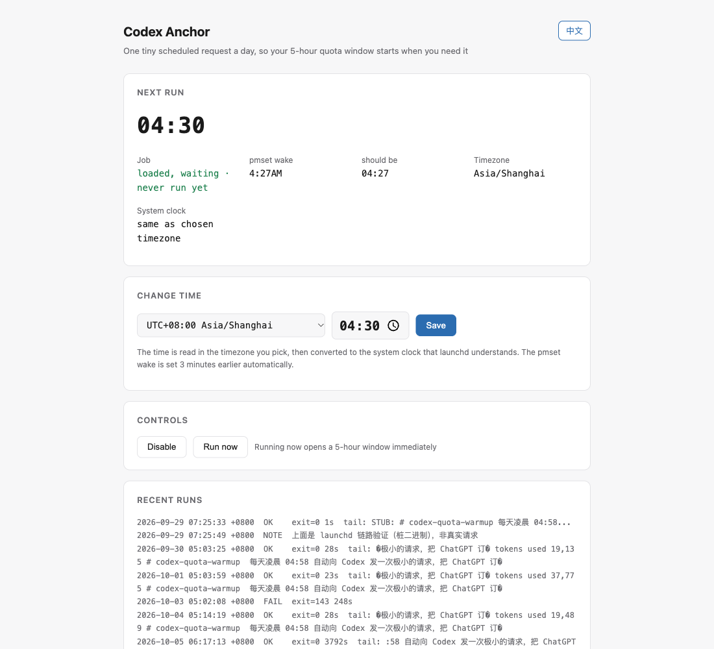

# codex-anchor-mac

[](README.md)
[](README.zh-CN.md)

Anchor your ChatGPT subscription's 5-hour usage window at a time you choose, so
the window boundaries fall **inside** your working day instead of after it.

> **This does not add quota and does not bypass any limit.** It sends one
> deliberately tiny request so the rolling window *starts* at a useful moment.
> You get the same amount of usage per window as everyone else.

**For ChatGPT Plus, on macOS.** Two deliberate limits:

- **Plus, not Pro.** Plus got the 5-hour window back on 25 Aug 2026;
  [OpenAI's pricing docs](https://developers.openai.com/codex/pricing) say Pro
  plans currently have no five-hour limit at all. On Pro there is no window to
  anchor and the weekly cap is what binds, so this tool does nothing for you.
- **macOS, not cross-platform.**

---

## The problem

Codex, Work, workspace agents and ChatGPT for Excel share a usage pool that
resets on a rolling 5-hour window. The window starts at your **first** request,
not on a clock boundary.

So if you sit down at 08:00 and burn through a window's quota in two hours:

```
08:00  first message  ->  window runs 08:00-13:00
10:00  quota exhausted
10:00-13:00  three hours of waiting
```

A anchor request before you wake up shifts the boundaries earlier, which puts
*more* boundaries inside your working day:

```
05:00  anchor (a few seconds, negligible quota)  ->  window runs 05:00-10:00
08:00  you start work with a full, untouched window
10:00  quota exhausted -- and the window rolls over at the same moment
10:00  new window 10:00-15:00, no waiting
```

## Picking your time

```
anchor time = wake-up time + how long a window lasts you - 5h
```

Wake at 08:00 and exhaust a window in 2h? `08:00 + 2h - 5h = 05:00`.
Wake at 07:30 with the same burn rate? `04:30`.

Setting it **too early** is worse than not setting it at all: the first window
expires before you can use much of it, and you waste the part you slept through.

## Why macOS specifically

Most anchoring tools are a cron line. On macOS that quietly does not work, in two
ways that produce **no error** — just a job that silently misses its time.

**1. TCC blocks launchd from protected folders.** Put the script in
`~/Documents`, `~/Desktop` or `~/Downloads` and launchd fails with
`Operation not permitted` (exit 126). Installation looks fine, because your
terminal has access and launchd does not. `install.sh` refuses to install from
those folders.

**2. A scheduled wake lands in DarkWake.** `pmset` can wake a sleeping Mac, but
it wakes into DarkWake, which honours "Sleep Service Back to Sleep" over an
idle assertion and freezes the request mid-flight. Measured on one machine over
ten nights:

| Power | Nights | Trigger set to | Request actually sent |
|---|---|---|---|
| AC | 5 | 04:58 | 05:02 – 05:14 |
| Battery | 3 | 04:58 | 05:27, 06:17, **06:56** |

A two-hour drift, with a log line that still says success. This tool forces a
real wake with `caffeinate -u`, then blanks the display again so nothing lights
up at 4am.

## Install

```bash
git clone https://github.com/unnamedhoead/codex-anchor-mac.git ~/codex-anchor-mac
cd ~/codex-anchor-mac && ./setup.sh
```

That is the whole install. `setup.sh` sets up the job, starts the control
panel and opens it in your browser.

```bash
./setup.sh --no-panel   # just the anchor job
./setup.sh --no-wake    # skip the admin prompt entirely
```

Do **not** put the folder in `~/Documents`, `~/Desktop` or `~/Downloads`
(see above). The installer will stop you.

`install.sh` needs no privileges for the core job. It then offers to schedule a
daily wake, which does need admin rights; it asks once through the standard
macOS authorization dialog (Touch ID works). **You can decline** — the anchor
still runs, it is just late on nights the Mac is asleep on battery. If your Mac
stays awake on AC power, you do not need it at all.

Set `ANCHOR_INSTALL_SUDOERS=0` to skip the narrow `sudoers` rule that lets the
control panel change the wake time later without prompting.

## Control panel



`setup.sh` runs a small server on `http://127.0.0.1:7788` (localhost only)
that lets you:

- change the trigger time, in a timezone you pick
- enable or disable the job
- trigger a run manually
- read the last 15 runs
- switch the interface between English and 中文

Changing the time keeps the launchd job, `install.sh` and the `pmset` wake in
sync, so they cannot drift apart.

## Timezones

launchd only understands the system clock. The panel converts to system-local
time before writing the schedule, so `04:30 Asia/Shanghai` becomes whatever
that is on your machine.

The picker lists 58 zones, not all 598. They are collapsed by their
*(January, July)* offset pair, so one entry stands for one real set of rules
including DST — collapsing by current offset instead would put Europe/London
and Africa/Abidjan in the same bucket, and they differ for half the year.
Your Mac's own zone is always in the list.

If the system timezone later changes — you travelled — the panel shows a banner
and one click re-syncs. Avoid scheduling inside your region's DST transition
hour (commonly 01:00–03:00); that wall-clock time may not exist on changeover
day.

## How it works

`anchor.sh` runs one `codex exec` against the Codex CLI bundled in ChatGPT.app
(or on `PATH`), with:

- `-s read-only` — an explicit sandbox, so an unattended job never inherits a
  permissive global config
- `--ephemeral` — no session history
- a 240-second watchdog and a directory lock
- a prompt that reads this README and prints its first 100 characters, which
  doubles as a health check: if the log tail looks wrong, something is wrong

It logs to `anchor.log`:

```
2026-10-07 05:02:18 +0800  OK  exit=0 22s tz=CST+0800  tail: # codex-anchor-mac ...
```

**It must authenticate as a ChatGPT subscription** (`auth_mode = chatgpt` in
`~/.codex/auth.json`). An OpenAI API key is billed separately and will not
start a subscription window at all.

## Development

```bash
./test.sh
```

28 smoke tests, all against a stub binary in a throwaway directory, so no real
request is ever sent and no quota window is opened. They cover `anchor.sh`'s
success, empty-output, failure, watchdog, missing-binary and locking paths, the
timezone conversion, and the guards (TCC refusal, strict-XML plists, sudoers
syntax). CI runs them on `macos-latest`.

## Known limitations

- A powered-off Mac cannot be woken. `pmset` only wakes it from sleep.
- macOS may skip a scheduled wake on low battery.
- Logging out or switching users unloads the LaunchAgent. Locking the screen is
  fine.
- The DarkWake workaround is **not independently verified** beyond the author's
  machine. If your log shows `[machine slept mid-run; anchor landed late]`,
  it did not work for you — please open an issue with the power log.
- Window behaviour is decided server-side by OpenAI and can change. The
  authoritative reset time is `/status` inside Codex.

## Uninstall

```bash
./uninstall.sh
```

## License

MIT. See [LICENSE](LICENSE).
